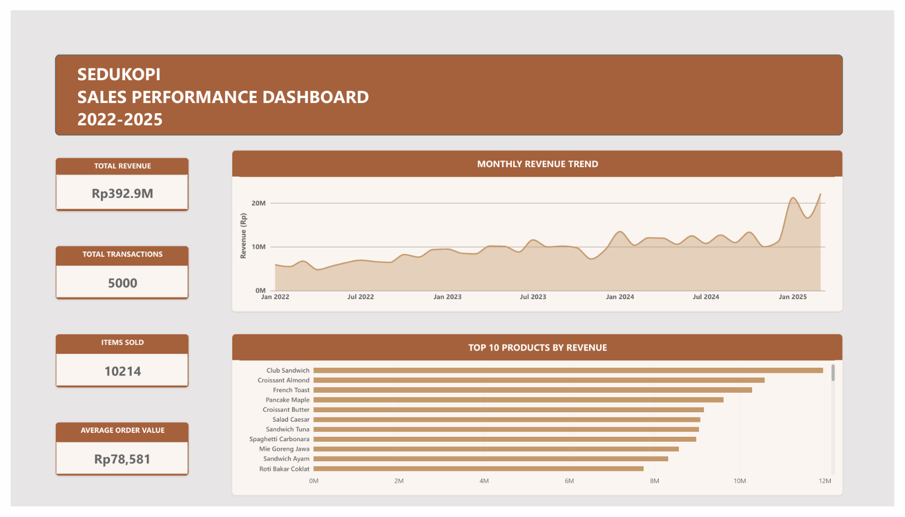

# Sedukopi Sales Analysis

**End-to-End Data Analytics Project | Google BigQuery SQL & Microsoft Power BI**

## 📌 Project Overview

This project focuses on analyzing sales performance for Sedukopi, a coffee shop business dataset, using Google BigQuery SQL and Microsoft Power BI.

The analysis aims to understand overall sales performance, monthly revenue trends, product performance, outlet contributions, and customer payment preferences.

Through SQL queries and interactive data visualization, this project transforms raw sales data into meaningful business insights and actionable recommendations.

## 🎯 Business Objectives

The main objectives of this project are:

- Evaluate overall sales performance and revenue.
- Identify monthly revenue trends and fluctuations.
- Determine the highest-revenue products.
- Compare sales performance across different outlets.
- Analyze customer payment method preferences.
- Provide business recommendations based on data findings.

## 🛠️ Tools & Technologies

| Tool | Purpose |
|---|---|
| Google BigQuery | SQL data analysis and querying |
| SQL | Data aggregation, filtering, joining, and analysis |
| Microsoft Power BI | Interactive dashboard and visualization |
| GitHub | Project documentation and portfolio |

## 📂 Dataset Overview

The dataset contains sales transaction information from Sedukopi.

**Main data attributes:**

- Order ID
- Order Date
- Payment Method
- Outlet ID and Outlet Name
- City
- Product Name
- Product Category
- Quantity
- Unit Price
- Subtotal

A SQL View named `vw_sales_detail` was created to combine relevant sales, outlet, and product information for analysis.

## 🔍 SQL Analysis

The analysis consists of six main queries:

| No. | SQL Analysis | Business Purpose |
|---|---|---|
| 01 | Overall Sales Analysis | Measure total revenue, transactions, and average order value |
| 02 | Monthly Sales Trend | Analyze monthly revenue development |
| 03 | Product Performance | Identify top-performing products |
| 04 | Outlet Performance | Compare revenue and transactions across outlets |
| 05 | Payment Method Analysis | Evaluate payment preferences and revenue contributions |
| 06 | Detailed Product Performance | Compare product revenue, quantity sold, and transactions |

**SQL techniques used:**

- SELECT and WHERE
- SUM(), COUNT(), AVG()
- COUNT(DISTINCT)
- GROUP BY and ORDER BY
- DATE_TRUNC()
- INNER JOIN
- SAFE_DIVIDE()
- SQL Views

## 📊 Key Business Findings

### 1. Overall Sales Performance

- Total Revenue: **Rp392,905,000**
- Total Transactions: **5,000**
- Total Items Sold: **10,214**
- Average Order Value (AOV): **Rp78,581**

**Key Insight:**

Sedukopi generated Rp392.9 million in revenue from 5,000 transactions. Customers purchased approximately 2.04 items per transaction on average.

### 2. Monthly Revenue Trend

- Monthly revenue generally shows an upward trend throughout the observation period.
- Revenue fluctuates across different months.
- A noticeable increase appears near the beginning of 2025.

**Key Insight:**

The business demonstrates positive revenue development, although further investigation is needed to understand the factors behind monthly fluctuations and the significant increase in early 2025.

### 3. Product Performance

The Top 10 products by revenue include:

| Product | Quantity Sold | Revenue |
|---|---:|---:|
| Club Sandwich | 166 | Rp11,952,000 |
| Croissant Almond | 145 | Rp10,585,000 |
| French Toast | 141 | Rp10,293,000 |
| Pancake Maple | 163 | Rp9,617,000 |
| Croissant Butter | 176 | Rp9,152,000 |
| Salad Caesar | 144 | Rp9,072,000 |
| Sandwich Tuna | 139 | Rp9,035,000 |
| Spaghetti Carbonara | 134 | Rp8,978,000 |
| Mie Goreng Jawa | 126 | Rp8,568,000 |
| Sandwich Ayam | 160 | Rp8,320,000 |

**Key Findings:**

- Club Sandwich generated the highest revenue at Rp11.95 million.
- Croissant Butter recorded the highest sales volume at 176 units.
- All Top 10 products belong to the Food category.
- The Top 10 products generated a combined revenue of Rp95.57 million, approximately 24.33% of total revenue.

### 4. Outlet Performance

The five highest-revenue outlets are:

| Outlet | Transactions | Revenue |
|---|---:|---:|
| Senopati | 318 | Rp25,534,000 |
| Malioboro | 310 | Rp24,383,000 |
| Cipete | 298 | Rp24,308,000 |
| Pondok Indah | 311 | Rp23,864,000 |
| Tunjungan | 283 | Rp23,859,000 |

**Key Findings:**

- Senopati recorded the highest revenue at Rp25.53 million.
- The five highest-revenue outlets generated Rp121.95 million combined.
- These outlets contributed approximately 31.04% of total revenue.

### 5. Payment Method Analysis

| Payment Method | Transactions | Revenue | AOV |
|---|---:|---:|---:|
| QRIS | 1,266 | Rp101,508,000 | Rp80,180 |
| GoPay | 1,185 | Rp94,325,000 | Rp79,599 |
| OVO | 993 | Rp77,494,000 | Rp78,040 |
| Cash | 794 | Rp60,688,000 | Rp76,433 |
| Debit Card | 762 | Rp58,890,000 | Rp77,283 |

**Key Findings:**

- QRIS generated the highest revenue at Rp101.51 million.
- GoPay ranked second with Rp94.33 million.
- QRIS and GoPay accounted for approximately 49.84% of total revenue.
- QRIS, GoPay, and OVO contributed approximately 69.57% of total revenue.
- QRIS recorded the highest AOV at Rp80,180.

## 💡 Business Recommendations

Based on the analysis, the following recommendations are proposed:

| Business Area | Recommendations |
|---|---|
| Overall Sales | Introduce product bundling, cross-selling, and upselling strategies to increase average transaction value. |
| Monthly Revenue | Investigate high- and low-performing months to identify potential seasonal patterns and promotional opportunities. |
| Product Performance | Maintain sufficient inventory for high-revenue products and evaluate products using both revenue and quantity sold. |
| Outlet Performance | Analyze high-performing outlets, particularly Senopati, and identify opportunities to improve other outlets. |
| Payment Methods | Maintain QRIS and e-wallet availability while evaluating the effectiveness of digital payment promotions. |

## 📈 Power BI Dashboard

The Power BI dashboard provides a visual overview of Sedukopi's sales performance.

**Dashboard Highlights:**

- Total Revenue
- Total Transactions
- Items Sold
- Average Order Value
- Monthly Revenue Trend
- Top 10 Products by Revenue

## 📁 Project Files

All project files are available below:

- 📊 [Download Power BI Dashboard (.pbix)](Power%20BI/Sedukopi_Sales_Analysis.pbix)
- 🖼️ [View Dashboard Preview](Dashboard_Preview.png)
- 🗄️ [Browse SQL Queries](SQL/)

### SQL Scripts

1. [Overall Sales Analysis](SQL/01_Overall_Sales_Analysis.sql)
2. [Monthly Sales Trend](SQL/02_Monthly_Sales_Trend.sql)
3. [Product Performance](SQL/03_Product_Performance.sql)
4. [Outlet Performance](SQL/04_Branch_Performance.sql)
5. [Payment Method Analysis](SQL/05_Payment_Method_Analysis.sql)
6. [Detailed Product Performance](SQL/06_Product_Performance_Detail.sql)

## 🎯 Project Conclusion

This project demonstrates how SQL and Power BI can be used together to analyze business performance and support data-driven decision-making.

The findings highlight the importance of monitoring revenue trends, product performance, outlet contributions, and payment preferences.

The analysis also provides opportunities for further investigation, including customer purchasing behavior, product profitability, and inventory optimization.

## ⚠️ Notes & Limitations

- Revenue is calculated using the dataset's subtotal field and should not be interpreted as net profit.
- The analysis is based on the available dataset and does not establish causal relationships.
- Business recommendations are proposed based on observed sales patterns and require further validation using operational data.

## 👨‍💻 Author

**Iqbal Baihaqy**

Aspiring Data Analyst | Data Analytics Enthusiast

- GitHub: [@balemorn](https://github.com/balemorn)
- Tools: Google BigQuery SQL, Microsoft Power BI
- Skills: SQL Analysis, Data Visualization, Business Intelligence, Data Cleaning, and Business Insights.

This project is part of my data analytics portfolio, demonstrating my ability to transform raw data into meaningful business insights and actionable recommendations.
